<h1 align="center"> Goat Bot - Bot Chat Messenger</h1>
<p align="center"><b>Modified and enhanced by <a href="https://github.com/lazyneoaz">@lazyneoaz</a></b></p>

<p align="center">
	<a href="https://nodejs.org/dist/v20.18.1">
		
	</a>
  
  
  
  
  
  
  
  
</p>

- [📝 **Note**](#-note)
- [🚧 **Requirement**](#-requirement)
- [✨ **Features (fca-meta build)**](#-features-fca-meta-build)
- [📡 **Chat API — fca-meta**](#-chat-api--fca-meta)
- [📝 **Tutorial**](#-tutorial)
- [💡 **How it works?**](#-how-it-works)
- [🔔 **How to get notification when have new update?**](#-how-to-get-notification-when-have-new-update)
- [🆙 **How to Update**](#-how-to-update)
- [🛠️ **How to create new commands**](#️-how-to-create-new-commands)
- [💭 **Support**](#-support)
- [📚 **Support Languages in source code**](#-support-languages-in-source-code)
- [📌 **Common Problems**](#-common-problems)
- [❌ **DO NOT USE THE ORIGINAL UNDERGRADUATE VERSION**](#-do-not-use-the-original-undergraduate-version)
- [📸 **Screenshots**](#-screenshots)
- [✨ **Copyright (C)**](#-copyright-c)
- [📜 **License**](#-license)

<hr>

## 📝 **Note**
- This is a messenger chat bot using a personal account, using an [unofficial api](https://github.com/ntkhang03/fb-chat-api/blob/master/DOCS.md) ([Origin here](https://github.com/Schmavery/facebook-chat-api)) and this may lead to facebook account being locked due to spam or other reasons. 
- So, I recommend using a clone account (one that you're willing to throw away at any time)
- ***I am not responsible for any problems that may arise from using this bot.***

### 📡 **Session reliability (fca-meta)**
- This build uses the [`fca-meta`](https://www.npmjs.com/package/fca-meta) npm package (`0.0.1`) as the chat API. It speaks the current Meta Lightspeed/DGW protocol, so it avoids the logout/suspend issues of the legacy MQTT endpoint.
- **Cookie rotation** is applied on every HTTP response (mautrix `Cookies.UpdateFromResponse`), and `autoRefreshFbstate` persists the rotated cookies back to `account.txt`, so short-lived cookies (`fr`, `sb`) never go stale on a long-running bot.
- **Stale bootstrap recovery**: a request rejected with `1357001`/`1357004` (the "text works but uploads don't" case) triggers one full reconnect that re-reads the bootstrap page and retries, instead of failing every later request.
- **Periodic reconnect** (mautrix `periodicReconnect`) force-refreshes the session every 20h by default, so tokens and sync cursors never go stale.

## 🚧 **Requirement**
- **Node.js 20.x or newer is required** — this build targets the modern runtime, and the prebuilt `canvas`/`sqlite3` binaries need Node 20+. [Download](https://nodejs.org/dist/v20.18.1) | [Home](https://nodejs.org/en/download/) | [Other versions](https://nodejs.org/en/download/releases/)
- Knowledge of **programming**, javascript, nodejs, unofficial facebook api

## ✨ **Features (fca-meta build)**

This fork adds Messenger features that the stock Goat-Bot-V2 does not ship. Each one is a ready command under `scripts/cmds/`.

| Command | Aliases | What it does |
| --- | --- | --- |
| `music` | `ms`, `msticker` | Search the Messenger catalogue and send a song as a real **music sticker**. `-c <count>` shows a picker; reply with a number to choose. |
| `effect` | `effects`, `pow` | Send a Messenger **text effect / power-up** (love, gift box, confetti, fire, celebration, ...). `list` shows every effect. |
| avatar effects | via `effect` | Send an **avatar effect** (`avatar_love`, `avatar_anger`, `avatar_laugh`, `avatar_cry`) with a bundled GIF. |
| `sing` | — | Send an actual **audio file** for a query. `-c <count>` shows a picker. |
| `bump` | `b` | **Bump** a replied message back to the top of the thread. |
| `unsendonreaction` | `uor` | Auto-**unsend a bot message** when an admin reacts with a configured emoji. |
| `noprefix` | `np` | Let admins run commands with **no prefix** when the first word is an exact command name/alias. |
| `wl` / `sl` | `whitelistmode` / `selflistenmode` | Toggle **whitelist** and **self-listen** modes at runtime. |
| `pending` | — | Review and **accept/decline message requests**. |
| `shell` | `sh`, `exec`, `run` | Run **shell commands** from chat (admin only). |
| `uptime` | `up`, `runtime`, `sysinfo` | Show **uptime and system info** (sent as an avatar effect). |

Other additions: **cookie rotation** back to `account.txt`, **stale-session recovery**, **full/periodic reconnect**, and a reworked **event formatter** that keeps the legacy `fb-chat-api` event shape and de-duplicates replayed messages.

## 📡 **Chat API — fca-meta**

The bot loads its chat API from the published [`fca-meta`](https://www.npmjs.com/package/fca-meta) package:

```bash
npm install
```

`bot/login/login.js` resolves it as a normal dependency:

```js
const login = require("fca-meta");
```

`fca-meta` is `fb-chat-api` compatible, so the bot's existing `api.sendMessage` / `api.listenMqtt` code needs no changes. It is backed by a hosted `fca-meta-server` that holds the protocol implementation, and your cookies are only used to establish your own session (encrypted at rest).

- **Session** — cookie/appState login, realtime listening, `getAppState`, `refreshFb_dtsg`, `forceReconnect`, `logout`.
- **Messaging** — `sendMessage`, `editMessage`, `unsendMessage`, `setMessageReaction`, `bumpMessage`/`bumpThread`, polls, attachments.
- **Music & effects** — `searchMusic`, `sendMusicSticker`, `sendEffect`, `sendAvatarEffect`.
- **Themes** — `createAITheme`, `setThreadTheme`, `changeTheme`.
- **Threads & users** — thread list/info/history, nickname, colour, emoji, admin, block, friend requests.

To point at your own server, add to `config.json`:

```json
{
  "chatApiServer": {
    "url": "https://your-server.example.com",
    "apiKey": "your-shared-key"
  }
}
```

## 📝 **Tutorial**
Tutorial has been uploaded on YouTube
- For mobile phone: https://www.youtube.com/watch?v=grVeZ76HlgA
- For vps/windows: https://www.youtube.com/watch?v=uCbSYNQNEwY
  
Summary instructions:
- See [here](https://github.com/ntkhang03/Goat-Bot-V2/blob/main/STEP_INSTALL.md)


## 💡 **How it works?**
- The bot uses the unofficial facebook api to send and receive messages from the user.
- When having a `new event` (message, reaction, new user join, user leave chat box,...) the bot will emit an event to the `handlerEvents`.
- The `handlerEvents` will handle the event and execute the command:
  - `onStart`:
    - the handler will check if user `call a command or not`.
    - if yes, it will check if `user banned` or mode `admin box only is turned on` or not, if not, it will execute the command.
    - next, it will check the `permission` of the user.
    - next, it will check if the `countdown` of command is over or not.
    - finally, it will execute the command and `log` information to the console.

  - `onChat`:
    - the handler will run `when the user sends a message`.
    - it will check `permission` of the user.
    - the handler will `execute` the command, if it return a `function` or `async function` then it willl check `user banned` or mode `admin box only is turned on` or not, if not, it will call the function and `log` information to the console.

  - `onFirstChat`:
    - the handler will run `when get the first message` from the chat box since the bot started.
    - the way it works is like `onChat`.

  - `onReaction`:
    - the handler will run when the user `reacts` to a `message has messageID` is set in `GoatBot.onReaction` as follows:
		```javascript
		// example:	
		global.GoatBot.onReaction.set(msg.messageID, {
			messageID: msg.messageID,
			commandName,
			// ... and more
		});
		```
    - the handler will automatically add method `delete`, if this method is called, it will delete the message from the set.
    - next, it will check `permission` of the user and `execute` if the user has permission and `log` information to the console.

  - `onReply`:
    - the handler will run when the user `replies` to a `message has messageID` is set in `GoatBot.onReply` as follows:
		```javascript
		// example:
		global.GoatBot.onReply.set(msg.messageID, {
			messageID: msg.messageID,
			commandName,
			// ... and more
		});
		```
    - the handler will automatically add method `delete`, if this method is called, it will delete the message from the set.
    - next, it will check `permission` of the user and `execute` if the user has permission and `log` information to the console.  

  - `onEvent`:
    - the handler will run `when the user has a new event` type `event` (new user join, user leave chat box, change admin box,...)
		```javascript
		// example:
		global.GoatBot.onEvent.set(msg.messageID, {
			messageID: msg.messageID,
			commandName,
			// ... and more
		});
		```
		- it will loop through all `onEvent` and get the command determined by the key `commandName` and execute the `onEvent` in that command.
		- if it return a `function` or `async function` then it will call the function and `log` information to the console.

  - `handlerEvent`:
    - the handler will run `when the user has a new event` type `event` (new user join, user leave chat box, change admin box,...)
    - it will get all the eventCommand set in `GoatBot.eventCommands` (scripts placed in the `scripts/events` folder)
    - it will loop through all `eventCommands` and run the `onStart` in that command.
    - if it return a `function` or `async function` then it will call the function and `log` information to the console.


## 🔔 **How to get notification when have new update?**
- Click on the `Watch` button in the upper right corner of the screen and select `Custom` and select `Pull requests` and `Releases` and click `Apply` to get notified when there is a new update.

## 🆙 **How to Update**
Tutorial has been uploaded on YouTube
- on phone/repl: https://youtu.be/grVeZ76HlgA?t=1342
- on vps/computer: https://youtu.be/uCbSYNQNEwY?t=508

## 🛠️ **How to create new commands**
- See [here](https://github.com/ntkhang03/Goat-Bot-V2/blob/main/DOCS.md)

## 💭 **Support**
If you have major coding issues with this bot, please join and ask for help.
- https://discord.com/invite/DbyGwmkpVY (recommended)
- https://www.facebook.com/groups/goatbot
- https://m.me/j/Abbq0B-nmkGJUl2C
- ~~https://t.me/gatbottt~~ (no longer supported)
- ***Please do not inbox me, I do not respond to private messages, any questions please join the chat group for answers. ThankThanks!***

## 📚 **Support Languages in source code**
- Currently, the bot supports 2 languages:
- [x] `en: English`
- [x] `vi: Vietnamese`

- Change language in `config.json` file
- You can customize the language in the folder `languages/`, `languages/cmds/` and `languages/events/`

## 📌 **Common Problems**
<details>
	<summary>
		📌 Error 400: redirect_uri_mismatch
	</summary>
	<p></p> 
	<p>1. Enable Google Drive API: <a href="https://youtu.be/nTIT8OQeRnY?t=347">Tutorial</a></p>
	<p>2. Add uri <a href="https://developers.google.com/oauthplayground">https://developers.google.com/oauthplayground</a> (not <a href="https://developers.google.com/oauthplayground/">https://developers.google.com/oauthplayground/</a>) to <b>Authorized redirect URIs</b> in <b>OAuth consent screen:</b> <a href="https://youtu.be/nTIT8OQeRnY?t=491">Tutorial</a></p>  
	<p>3. Choose <b>https://www.googleapis.com/auth/drive</b> and <b>https://mail.google.com/</b> in <b>OAuth 2.0 Playground</b>: <a href="https://youtu.be/nTIT8OQeRnY?t=600">Tutorial</a></p>
</details>

<details>
	<summary>
		📌 Error for site owners: Invalid domain for site key
	</summary>
		<p></p>
		<p>1. Go to <a href="https://www.google.com/recaptcha/admin">https://www.google.com/recaptcha/admin</a></p>
		<p>2. Add domain <b>repl.co</b> (not <b>repl.com</b>) to <b>Domains</b> in <b>reCAPTCHA v2</b> <a href="https://youtu.be/nTIT8OQeRnY?t=698">Tutorial</a></p>
</details>

<details>
	<summary>
		📌 GaxiosError: invalid_grant, unauthorized_client 
	</summary>
		<p></p>
		<p></p>
		<p></p>
		<p>- If you don't publish the project in google console, the refresh token will expire after 1 week and you need to get it back. <a href="https://youtu.be/nTIT8OQeRnY?t=445">Tuatorial</a></p>
</details>

<details>
	<summary>
		📌 GaxiosError: invalid_client
	</summary>
		<p></p>
		<p>- Check if you have entered your google project client_id correctly <a href="https://youtu.be/nTIT8OQeRnY?t=509">Tuatorial</a></p>
</details>

<details>
	<summary>
		📌 Error 403: access_denied
	</summary>
		<p></p>
		<p>- If you don't publish the project in google console only the approved accounts added to the project can use it <a href="https://youtu.be/nTIT8OQeRnY?t=438">Tuatorial</a></p>
</details>

## ❌ **DO NOT USE THE ORIGINAL UNDERGRADUATE VERSION**
- The use of unknown source code can lead to the device being infected with viruses, malware, hacked social accounts, banks, ...
- Goat-Bot-V2 is only published at https://github.com/ntkhang03/Goat-Bot-V2, all other sources, all forks from other github, replit,... are fake, violate policy
- If you use from other sources (whether accidentally or intentionally) it means that you are in violation and will be banned without notice
## 📸 **Screenshots**
- ### Bot
<details>
	<summary>
 		Rank system
	</summary>

  - Rank card:
  <p></p>

  - Rankup notification:
  <p></p>

  - Custom rank card:
  <p></p>
</details>

<details>
	<summary>
 		Weather
	</summary>
	<p></p>
</details>

<details>
	<summary>
 		Auto send notification when have user join or leave box chat (you can custom message)
	</summary>
	<p></p>
</details>

<details>
	<summary>
 		Openjourney
	</summary>
	<p></p>
</details>

<details>
	<summary>
 		GPT
	</summary>
	<p></p>
	<p></p>
	<p></p>
</details>


- ### Dashboard
<details>
	<summary>
 		Home:
	</summary>
	<p></p>
	<p></p>
</details>

<details>
	<summary>
 		Stats:
	</summary>
	<p></p>
</details>

<details>
	<summary>
 		Login/Register:
	</summary>
	<p></p>
	<p></p>
</details>

<details>
	<summary>
 		Dashboard Thread:
	</summary>
	<p></p>
</details>

<details>
	<summary>
 		Custom on/off:
	</summary>
	<p></p>
</details>

<details>
	<summary>
 		Custom welcome message (similar with leave, rankup (coming soon), custom command (coming soon))
	</summary>
	<p></p>
	<p></p>
</details>

## ✨ **Copyright (C)**
- **[NTKhang (NTKhang03)](https://github.com/ntkhang03)** — original Goat-Bot-V2 author
- **[lazyneoaz](https://github.com/lazyneoaz)** — modified and enhanced build (fca-meta chat API, music sticker / effect / bump features)

## 📜 **License**

**VIETNAMESE**

- ***Nếu bạn vi phạm bất kỳ quy tắc nào, bạn sẽ bị cấm sử dụng dự án của tôi***
- Không bán mã nguồn của tôi
- Không tự xưng là chủ sở hữu của mã nguồn của tôi
- Không kiếm tiền từ mã nguồn của tôi (chẳng hạn như: mua bán lệnh, mua bán/cho thuê bot, kêu gọi quyên góp, v.v.)
- Không xóa/sửa đổi credit (tên tác giả) trong mã nguồn của tôi

**ENGLISH**

- ***If you violate any rules, you will be banned from using my project***
- Don't sell my source code
- Don't claim my source code as your own
- Do not monetize my source code (such as: buy and sell commands, buy and sell bots, call for donations, etc.)
- Don't remove/edit my credits (author name) in my source code

